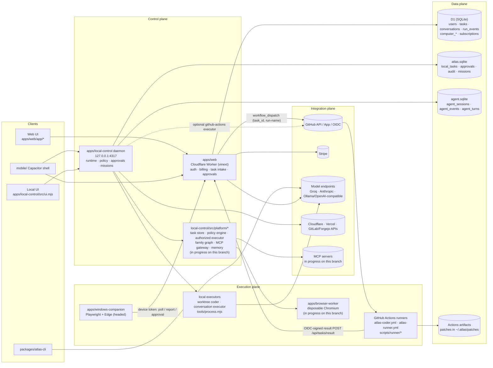
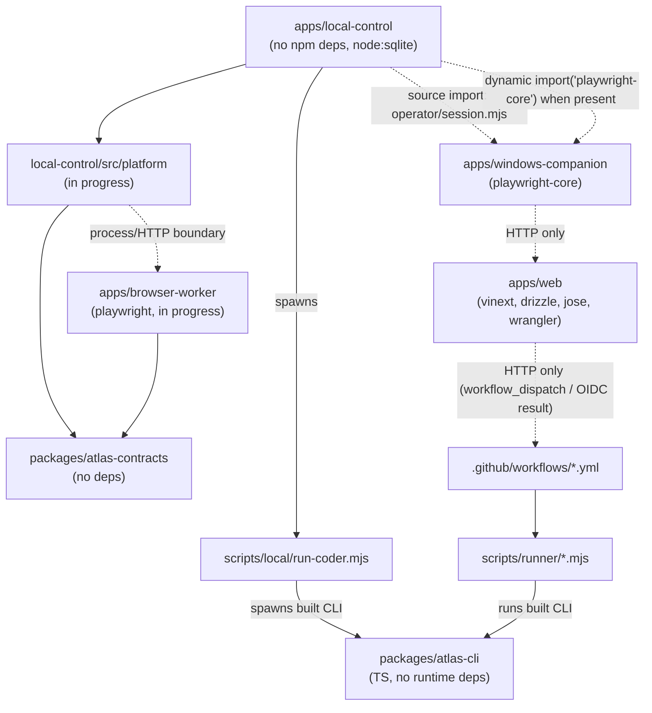

# Atlas capability evidence audit — refreshed 2026-10-15

## October 15 refresh (takes precedence over the October 12 snapshot below)

Current main and audit branch base: `dee7942d7fb4a3971229be1f2ca9d97e8cef3eaf`
(#285). The six-file delta from b47f136 changes streamed Markdown rendering,
Genesis capability preflight timeouts/cache and their tests, plus PROGRESS.
The earlier local-control, foundation and mobile test evidence below still
applies to unchanged sources; those suites were not relabeled as rerun today.

- [CI 38834441308](https://github.com/cornerstonemarketingus/atlas/actions/runs/38834441308)
  passes **all 13 jobs**, including Windows daemon/local-control and Genesis.
  The earlier Windows boot timeout is an unresolved intermittent observation,
  not evidence that current main consistently fails to boot. No root cause is
  established and a green rerun does not explain it.
- [Deployment 38834441273](https://github.com/cornerstonemarketingus/atlas/actions/runs/38834441273)
  succeeded. Hosted [chat 38834676029](https://github.com/cornerstonemarketingus/atlas/actions/runs/38834676029)
  passes one tool step and persisted replies in both modes: Groq non-streaming
  (344 characters), Workers AI streaming (335 characters). These traces were
  inspected during this refresh; they were dispatched by the existing release
  workstream, not newly dispatched here.
- [Chat 38834591463](https://github.com/cornerstonemarketingus/atlas/actions/runs/38834591463)
  passes both modes with **zero tool steps**, 175 characters from Workers AI.
  It proves response/persistence for that request, not Genesis creation.
- 38 open PRs are now inventoried. Additional #282 binds result callbacks to
  execution ownership: review with #278/#266/#270, require stale-attempt and
  cancelled-task negative tests. Additional #284 recovers Genesis project
  receipts on chat reopening: validate persisted receipts with #274/#276 and
  do not infer completed creation from a recovered notice. Neither is on main.
- Native/mobile visual browser acceptance remains unperformed. The attempted
  in-app browser session failed in its local sandbox before navigation. Main's
  browser regression job is automated evidence, distinct from a manual deployed
  browser journey.

No new major implementation preceded this audit. The immediate next reliability
work is to validate/reconcile existing execution/security PRs, then investigate
the intermittent Windows startup observation without masking it by timeout-only
changes. Independent subagent reviews were requested but returned no usable
findings in this session; no conclusions below rely on them.

Fresh refresh-only regression: `node --test
apps/web/tests/genesis-bridge-latency.test.mjs` passes **3/3** on dee7942,
including cancellation-ignoring transport, stalled body and unchanged creation
deadline. This is a transport fixture, not a live Genesis operation.

## October 12 detailed snapshot and evidence

Audited checkout: `b47f136a70d7cd3b2fcc3f17423229ac41ef3b3a` (main).
Ownership: [#279](https://github.com/cornerstonemarketingus/atlas/issues/279),
`codex/evidence-audit-1011`. This inventory supersedes current-status claims in
the dated inventory below and the October 9 TODO reconciliation. Historical
evidence remains useful only for its named commit and tested boundary.
No major implementation, merge, production migration or deployment was performed.
Uncommitted workforce/business changes in the owner's checkout were preserved
and are **not main capabilities**.

## Evidence levels and release findings

Source existence, runtime wiring, automated tests, a real process/browser
session, and a deployed acceptance result are different evidence levels.
"Verified" below applies only to the stated journey. A fixture-backed model
does not qualify model quality; a successful inspection does not qualify coding.

| Evidence | Result and scope |
|---|---|
| Fresh local-control suite, audited checkout | `node --test tests/*.test.mjs`: **692 tests; 672 passed, 20 skipped, zero failures**. Skips cover unavailable container/namespace/Xvfb isolation, CLI-dependent Genesis cases and Playwright UI cases; those boundaries were not freshly qualified locally. |
| Fresh inference/contracts/runner/local scripts | `node --test packages/atlas-inference/tests/*.test.mjs packages/atlas-contracts/tests/*.test.mjs scripts/runner/*.test.mjs scripts/local/*.test.mjs`: **137/137 passed**. Includes actual callback HTTP failures, ledger concurrency and simulated providers. |
| Fresh mobile shell tests | `node --test mobile/tests/*.test.mjs`: **7/7 passed**; no native install, push or physical phone qualification. |
| Fresh real daemon session | `node scripts/e2e/journey.mjs`: every step passed. Real child daemon, HTTP, SQLite, tool execution, exact approval/single consumption, denial, delegation, pause/resume/cancel, kill/restart and explicit resume; **scripted inference**. |
| Main CI | [38160397827](https://github.com/cornerstonemarketingus/atlas/actions/runs/38160397827): **FAILED**. Windows `daemon-boot.test.mjs` timed out after 15 seconds waiting for health, with no daemon output. Other 12 jobs passed, including web, CLI and Genesis real coder/browser harness. Cause unresolved; local success does not erase the failure. |
| Deployed inspection | [38160488156](https://github.com/cornerstonemarketingus/atlas/actions/runs/38160488156), runner [38160503256](https://github.com/cornerstonemarketingus/atlas/actions/runs/38160503256): task `48b9c53c-3e9d-44a3-92ba-9333e17e0e19`, result **Received and persisted**. No model-backed edit. |
| Fresh deployed model/tool chat | [38252392959](https://github.com/cornerstonemarketingus/atlas/actions/runs/38252392959), October 12, same commit: setup 8/8; non-streaming Groq `openai/gpt-oss-20b`, 319 characters, one tool step, stored; streaming Workers AI `@cf/openai/gpt-oss-120b`, 333 characters, one tool step, stored. Workers AI credential/models/inference probes HTTP 200. |
| Fresh visual deployed browser session | **Unavailable**: in-app browser kernel failed before opening a page (`apply deny-read ACLs`). No screenshot, visual/mobile usability or authenticated browser journey is claimed. HTTP acceptance above is a separate boundary. |

The fresh workflow dispatch returned GitHub HTTP 502, but subsequent read-only
inspection found run 38252392959 completed successfully. It was **not dispatched
again**. This is concrete evidence that an error acknowledging dispatch does
not establish that work never started. It supports the existing durable-dispatch
and request-idempotency workstreams, not a claim that main already handles them.

## Capability inventory

Paths abbreviate `LC = apps/local-control/src`, `W = apps/web`.
Automated coverage is the fresh suites above or named exact-commit CI, unless
explicitly stated otherwise. No percentages are inferred.

| Capability / classification | Source and connection to runtime | Automated / real session / deployed evidence and gap |
|---|---|---|
| Hosted chat and read-only tools — IMPLEMENTED AND VERIFIED (bounded journey) | `W/app/api/chat/{route.ts,agent-loop.mjs,providers.mjs}`; real chat UI/API, tool dispatch and conversation persistence | Fresh deployed streaming/non-streaming one-tool replies above. Long missions, arbitrary provider failure and client disconnect survival remain unqualified. |
| Hosted inference coordination — PARTIALLY IMPLEMENTED | `packages/atlas-inference/src`, `W/app/api/inference/governor-client.mjs`, `W/worker/inference-governor*.mjs`; `governedSend` used by hosted loop; DO binding in `W/vite.config.ts` | Fresh ledger/provider fixtures pass. CLI/Actions and local inference do not share this allowance; global budget/release-on-crash qualification missing. |
| Commercial/open model routing — PARTIALLY IMPLEMENTED | Hosted providers plus CLI `infrastructure/*model-provider.ts`, local `agent/models`; Workers AI uses REST compatible endpoint | Live Groq and Workers AI chat now established. OpenAI paid availability, Anthropic live use, local Ollama coding/tool quality and privacy-safe fallback across all routes not verified. Native Workers AI repair remains #240. |
| Verified coder — IMPLEMENTED AND VERIFIED (harness), production reliability PARTIAL | `packages/atlas-cli/src/agent/verified-coder-session.ts`, `scripts/runner/run-task.mjs`, Actions workflows; real edits and checks, bounded repairs and result reporting | Main CLI and Genesis harness CI pass. No fresh repeated real-model coding missions with provider outages/interruption; Phase 1 acceptance remains open. |
| Callback delivery — IMPLEMENTED AND VERIFIED (transport and normal hosted path) | `scripts/runner/report-result.mjs` and `W/app/api/tasks/result/route.ts`; #246 merged; stable result identities and bounded transient retries | Fresh regression suite plus deployed inspection persisted. Lost-ack test uses HTTP fixture; no live D1/OIDC network-fault injection. Old BROKEN row below is superseded. |
| Hosted task dispatch/idempotency — PARTIALLY IMPLEMENTED | `W/app/api/tasks/{route.ts,dispatch.mjs}`, D1 task rows and Actions run identity | Main still lacks the pending #270/#274/#278 intent, client-request dedupe and worker execution fencing. GitHub 502 observed during this audit makes uncertainty material. |
| Unified cloud lifecycle / LOCAL-CLOUD-HYBRID — NOT IMPLEMENTED end to end | Existing local stores/kernel, D1 task history, Actions workers are reusable but separate | No generic externally durable filesystem/checkpoint/lease/tool-receipt runtime supporting all three modes. Phone/tab-independent inspection exists; durable Genesis/local automations do not move to cloud automatically. |
| Local lifecycle and recovery — IMPLEMENTED AND VERIFIED (explicit resume) | `LC/agent/{runtime,session-store,mission-service,mission-scheduler}.mjs`, local SQLite | Fresh real daemon restart/resume journey passes. This does not prove an arbitrary interrupted consequential tool is never repeated. Automation uncertain-start recovery remains #252. |
| Kernel and multi-agent command center — PARTIALLY IMPLEMENTED | `LC/agent/kernel`, `LC/platform/command-center.mjs`, mission/team services, `main.mjs`, server and UI | Real delegation/tool evidence in daemon journey. Hosted and CLI loops remain distinct; one global cost/control view and intentional-defect independent-review acceptance not established. |
| Credential broker — PARTIALLY IMPLEMENTED | `LC/agent/credential-vault.mjs`, tool registry; hosted GitHub App/OAuth resolution | Existing vault/allowlist tests pass; short-lived capability broker and final execution boundary fixes in #233/#235, not main completion. No unrestricted credential expansion is authorized. |
| Approval/security boundaries — PARTIALLY IMPLEMENTED | Local authorized executor/policy/store, hosted computer approval routes, CLI policy wrappers | Real deny, exact approval and one-use consumption pass locally. Universal principal/task/environment/argument/expiry binding and cloud credential timing need #235 and integration qualification. |
| Sandbox/isolation — PARTIALLY IMPLEMENTED | `LC/platform/terminal`, CLI command/process controls, local sandbox config, trusted Actions checkout | Existing tests/CI do not establish all generated-code validation is isolated from trusted runner secrets. #253 owns this blocker. No fallback to unrestricted host execution may be introduced. |
| Genesis creation/spec/change/preview — PARTIALLY IMPLEMENTED | `LC/platform/genesis`, templates, tools/server; new hosted bridge `W/app/api/genesis/{bridge.mjs,operations/route.ts}` and `/api/tasks` routing landed #272 | Local suite and main Genesis real CLI/Chromium harness pass. Hosted bridge requires configured trusted execution node; it is not a cloud worker. Team Hahn real-model website acceptance not run. |
| Genesis visual editor — PARTIALLY IMPLEMENTED (preview), selection editing NOT ON MAIN | Existing previews/inspection; open #181 contains static text selection/source mapping | Do not duplicate #181. Source-backed color/layout/move/delete/component alternatives and live responsive visual QA remain incomplete. |
| Genesis deployment/backend — PARTIALLY IMPLEMENTED | Shared auth/files/secrets/jobs/queue templates; `LC/platform/genesis/publish.mjs` and infrastructure tools | Reusable local backend templates and publish checks exist. Server-backed production database/migrations/backups/rollback/health and Team Hahn deployed artifact not verified. |
| Cloud browser — NOT IMPLEMENTED executor | `W/app/api/computer/browser-plan.mjs`: `HOSTED_BROWSER_EXECUTOR_AVAILABLE = false`; task route refuses unsupported work | Explicit refusal is wired; no cloud consumer executing browser tasks with owner PC off. |
| Local browser/operator — PARTIALLY IMPLEMENTED | `apps/browser-worker`, `apps/windows-companion`, local browser adapters and authorized operator | Browser-worker/companion CI pass; #237 takeover journal unmerged. No fresh browser challenge/approval/interruption/hand-back journey performed here. |
| MCP / signed skills — PARTIALLY IMPLEMENTED | LC configured MCP client/gateway and registry; `LC/platform/skills` packaging/approvals/proposals | Library tests and configured local transport exist. Approved signed skill installation/loading/revocation into all runtimes and capability-gap-to-reviewed-skill loop incomplete. |
| Replay/evaluation/self-improvement — PARTIALLY IMPLEMENTED | CLI replay/audit, LC reviewer/isolated worktree; open #236 eval and #243 verified-commit merge binding | Tests/records are not a production benchmark. Independent intentional-defect catch, review isolation, exact-head merge/rollback gates incomplete on main. Protected changes need owner review. |
| Business lead-to-completion — NOT VERIFIED end to end | Genesis forms/backend and opportunity/goal modules; #223 opportunity scout pending | No test customer estimate -> durable lead -> owner notification -> tracked completion acceptance. Dirty workforce/business files are excluded. SEO/GEO actual indexing/conversion measurement not established. |
| Tenant/auth/billing/onboarding — PARTIALLY IMPLEMENTED | `W/app/api/auth`, tenant/repository guards, billing routes/plan, setup UI | Main web CI passes and forged identity is denied by hosted gate. Fresh independent-user signup/repo/approval/project acceptance absent. Atomic billing #203 and API limiting #69 need reconciliation; paid Stripe setup not established. |
| Mobile / Windows install-update — PARTIALLY IMPLEMENTED | Capacitor `mobile`, Windows release tooling, local companion | Fresh mobile shell 7/7 and release-tooling CI pass. Clean-machine installer/update and physical-phone takeover/offline cloud coding untested; #61 pending. |

## Disconnected and incomplete infrastructure

Historical `ChildAgentRegistry`, orchestrator `TaskDag`/`AgentLoop`, capability
router and signed SkillRegistry modules are library infrastructure, not proof of
a unified production agent OS. Their actual import/instantiation path must be
the acceptance gate when wiring them. Existing kernel/mission and MCP paths
should be reused rather than replaced. The owner's dirty workforce integration
must be reviewed separately before changing these conclusions.

Deployment currently binds D1 and an inference Durable Object through
`W/vite.config.ts`; that governor is not a durable general-purpose agent worker.
Secret **names only** were inventoried: model, Cloudflare, D1, GitHub, operator
and session configuration are present. No `ATLAS_GENESIS_URL/TOKEN`, Anthropic
or Stripe secret names appeared in GitHub. This does not reveal manual Worker
configuration and does not prove absence there. Never infer balance, permission
or health from a secret name alone.

## Open PR and branch reconciliation

Snapshot includes all 36 open PRs seen during the October 12 audit. UNKNOWN
mergeability means GitHub has not computed it; it is not a clean or conflicting
verdict. Recommendations below are dispositions for review, not authorization
to merge failing/protected changes or close another agent's work without review.

| PRs | Disposition and reuse |
|---|---|
| #270, #274, #276, #278 | Validate/reconcile as a dependency stack: persisted dispatch intent, request dedupe, inspection and execution fencing. Protected tenant/worker boundaries require owner review. Keep exact run/task receipts; do not start a duplicate queue abstraction. |
| #266 | Reconcile cancellation against that stack, test late callbacks/stale attempts and durable receipts; not full pause/resume. |
| #253 | Review isolation before live consequential coder acceptance; preserve trusted/untrusted boundary and workflow owner review. |
| #252 | Validate automation uncertain-start recovery; do not replay an unknown mission. CI green recorded; still unmerged. |
| #243, #235, #233 | Priority security reconciliation: exact verified-head merge, approval/credential execution boundaries, broker. Preserve owner review; resolve overlap rather than merging both implementations blindly. |
| #240, #178 | Reconcile native Workers AI transport with selected-provider hosted acceptance; REST live success does not qualify native cancellation. |
| #200 | Repair failed CLI CI and reconcile current CLI changes; billing taxonomy/local provider work is not superseded by hosted governor. |
| #230 | Rebase/qualify local models, retain guided setup and measured real coding/tool evidence. |
| #181, #101 | Rebase unique visual editing/repository creation over current Genesis bridge and local publisher; no duplicate Genesis infrastructure. |
| #203, #69, #77 | Rebase/repair atomic billing, hosted rate limiting and CSP; protected review and concurrency/security tests. |
| #237, #105, #61 | Validate/rebase takeover, browser adapter and mobile companion; actual browser and phone acceptance required. |
| #236 | Validate replay/evals with side effects prohibited; integrate real release evidence after runtime boundaries stabilize. |
| #207 | Compare unique cross-page immutable-content reuse against merged #205/#259/#265; port only missing behavior and close superseded remainder after review. |
| #191 | Dispatch persistence approach superseded by #270; preserve any unrelated UI/knowledge fixes before closure review. |
| #129–#133, #158, #160 | Hosted inference stack largely ported by #224. Diff review for unique capability/latency/cache behavior, then supersede/close duplicates; mergeability alone is insufficient. |
| #202 | Rebase unique untrusted tool-log wrapping; retain injection tests. |
| #223, #97, #98 | Rebase/review unique opportunity, durable knowledge and CI-awareness work after foundation; no claim that open code is deployed. |

`git branch -r --no-merged origin/main` was examined: it includes many
squash-merged historical branches as well as these open PR heads. Reachability
alone is not a missing-feature inventory. `atlas/task-*` run branches are
execution artifacts, not implementations to merge blindly. Uncommitted primary
checkout work and standalone historical branches are unqualified until their
diff, ownership and tests are reviewed; they were not imported into this audit.

## Phase acceptance still outstanding

1. Reliability: repeated real-model coding with deliberate provider refusal,
   interrupted sessions and exactly-once consequential-action evidence.
2. Genesis: Team Hahn Construction site built, visually reviewed and published
   through approved deployment; server-backed rollback/health if used.
3. Cloud: coding continues with owner's computer disconnected; durable files,
   checkpoints, fenced worker ownership and receipts, not just task history.
4. Browser: real supported form workflow with exact approval, interruption,
   takeover, fresh observation and continuation.
5. Collaboration: independent reviewer catches an intentionally planted defect
   before release within measured budgets.
6. Business: test estimate is stored, owner notified and completion tracked;
   actual indexing/performance/conversion evidence for SEO/GEO.
7. Customer release: clean Windows install/update and fresh-user project journey;
   unverified capabilities cannot be advertised as complete.

The prioritized queue in [BACKLOG.md](BACKLOG.md) is the next-work authority for
this audit. No phase acceptance above was substituted with a model's statement.

---

# Historical architecture and production audit — 2026-10-08

Snapshot: remote `main` `17570ff348baef91a7637153df93538d56629762`.
Workstream: #244, `codex/cloud-result-recovery`. This section supersedes the
September architecture claims below; it does not declare all production gates passed.
The governing program is `docs/PROGRAM.md` (no root `PROGRAM.md` exists).
Read `docs/ROADMAP.md`, `docs/TODO-MAP.md`, `docs/PROGRESS.md`, `TODO.md`,
`HANDOFF.md`, `HANDOFF-TODO.md`, `CLAUDE.md`, `SOVEREIGN-MODE.md`,
`LOCAL-MODEL.md`, and `LAUNCH.md`. Historical handoffs describe older snapshots:
LAUNCH's "Everything in code is done" and CURRENT-STATE's "Nothing on main is
broken" are not current acceptance evidence.

## A–B. Architecture inventory and verified functionality

A subsystem's status is scoped to the capability named in its row. A passing
fixture does not prove a hosted provider, an OAuth flow, or a native phone build.
Paths below are relative to the repository root; local `src/` and `platform/` abbreviate `apps/local-control/src/`.

| Subsystem / scope | Actual status | Runtime evidence and test limits |
|---|---|---|
| Hosted chat, repository tools and stored replies | IMPLEMENTED AND VERIFIED | `apps/web/app/api/chat/{route.ts,agent-loop.mjs}`, `app/api/conversations/`; live run 37858630572 on this snapshot: setup 8/8, streaming and non-streaming each performed one tool step, answered using Workers AI `@cf/openai/gpt-oss-120b`, and stored the reply. This is the tested one-round journey, not unlimited multi-round reliability. |
| Hosted quota coordination and fallback | PARTIALLY IMPLEMENTED | `packages/atlas-inference/src/`, `apps/web/app/api/inference/governor-client.mjs`, `apps/web/app/api/chat/agent-loop.mjs:governedSend`, `worker/inference-governor*.mjs`, `vite.config.ts`; #224 wired chat/team calls and atomic reservations. Package baseline 63/63; `apps/web/tests/inference-chaos.test.mjs` uses real ledger logic with fake providers. Runner CLI calls remain outside that shared governor. |
| CLI coding and validation | IMPLEMENTED AND VERIFIED | `packages/atlas-cli/src/{cli.ts,agent/verified-coder-session.ts}`; required main CI 37858362489 passes atlas-cli. Existing hosted coder runs 37012984754 and 36909261185 succeeded; newer runs 37062375957/37061184413 failed at Run Atlas task, while result reporting succeeded. Do not infer current model-backed coding success from CI's scripted model. |
| Cloud coder execution and durable results | PARTIALLY IMPLEMENTED | `.github/workflows/{atlas-coder,atlas-runner}.yml`, `scripts/runner/{validate-inputs,run-task,report-result}.mjs`, `apps/web/app/api/tasks/{route.ts,result/route.ts,runner-result.mjs}`; ephemeral Actions checkout, CLI checks, artifacts and OIDC-authenticated callback exist. Built-in runner permits only `cornerstonemarketingus/atlas`; callbacks retry 5xx but transport failures escape. No generic resumable cloud kernel. |
| Result callback transport recovery on main | BROKEN | `scripts/runner/report-result.mjs`; five new regressions initially fail, including real socket reset after accepting evidence. #244 fixes this on its branch: 10/10 callback and 68/68 affected script tests pass; not a deployed result yet. |
| Generic provider-neutral durable cloud agent lifecycle | NOT IMPLEMENTED | Existing Actions/local runtimes are separate; no complete durable cloud kernel/checkpoint/lease/artifact adapter supporting LOCAL/CLOUD/HYBRID is wired. |
| Paid Stripe onboarding in this deployment | BLOCKED BY EXTERNAL CONFIGURATION | Stripe code exists but GitHub secret inventory has no Stripe credentials/prices; no real payment journey verified. Owner configuration is required before billing acceptance. |
| Local sessions, mission lifecycle and recovery | IMPLEMENTED AND VERIFIED | `apps/local-control/src/agent/{runtime,session-store,mission-service,mission-scheduler}.mjs`; baseline 674 tests: 654 pass, 20 skipped, zero failures. Real daemon e2e passes policy denial, one-use approvals, pause/resume/cancel and kill/restart recovery using a scripted model. #225 retains cooldown/retry state; this is not resumable tool-message execution after any arbitrary crash. |
| Shared agent kernel and world state | PARTIALLY IMPLEMENTED | `src/agent/kernel/{kernel,world-state,capabilities,branching,economics}.mjs`, instantiated in `src/main.mjs`; team steps, coder harnesses and Genesis use it. Hosted chat and Actions CLI still have separate execution loops. `agent-kernel.test.mjs` covers the shared loop. Trace/world-state failures are caught: a trace alone is not proof of task durability. |
| Parallel missions and Command Center | IMPLEMENTED AND VERIFIED | `src/agent/mission-*.mjs`, `platform/command-center.mjs`, `src/server.mjs`, `src/ui.mjs`; `command-center.test.mjs`, mission suites and daemon e2e. Real service states are aggregated, not fake activity. Global hosted/local unification, complete cost accounting and all requested reasoning tiers remain partial. |
| Credential broker, OAuth and scoped execution grants | PARTIALLY IMPLEMENTED | Main has `agent/credential-vault.mjs`, tool-registry resolution, GitHub App installation-token support and env allowlists. Broker is in open #233; execution-boundary fixes in #235. Main is not a complete short-lived capability broker. OAuth refresh/rotation and universal app-secret provisioning are not established by current tests. |
| Approval / execution boundary | PARTIALLY IMPLEMENTED | `platform/{executor,policy,legacy-policy-bridge}.mjs`, `agent/tool-registry.mjs`, hosted `app/api/computer/approval-state.mjs`; daemon e2e proves basic deny/ask/consume. #235 addresses expiry, principal/context binding and adapter credential handling. Exact repository/revision/environment binding everywhere is not demonstrated on main. |
| Browser and optional local desktop control | PARTIALLY IMPLEMENTED | `apps/browser-worker/src/`, `apps/windows-companion/src/`, local `agent/{browser,tools}`; main CI browser-worker/companion pass. Disposable worker and egress policies exist; desktop requires its companion host online. Secure cloud browser session/takeover with mobile re-observation is not verified; #237 supplies an unmerged takeover journal. |
| Genesis application generation / preview / checks | IMPLEMENTED AND VERIFIED | `platform/genesis/{service,executor,coder,preview,inspector,publish}.mjs`, main wiring, `tests/genesis-*.test.mjs`; main CI Genesis job passes actual coder CLI + Chromium with a scripted model. No claim of real-model prompt-to-production deployment. Template auth/files/secrets/jobs/queue foundations are reused. |
| Genesis click-to-edit | PARTIALLY IMPLEMENTED | Open #181 has static-site text selection/editing. It conflicts with current main; not a shipped picker. General color/layout/delete/move/component variants remain incomplete. |
| MCP gateway and connectors | PARTIALLY IMPLEMENTED | `platform/mcp/{gateway,daemon-bridge,jsonrpc-stdio,http-transport}.mjs`; `main.mjs` wires explicitly configured stdio servers with allowed-tools and policy gates; `mcp-memory-runtime.test.mjs` uses a real subprocess. HTTP transport library is not the configured daemon bridge path. No finished hosted connector catalogue or universal OAuth lifecycle. |
| Signed skills / proposals / marketplace | IMPLEMENTED BUT NOT WIRED | `platform/skills/{package,skill-registry,proposals,approvals}.mjs`; `platform-skills.test.mjs`. `main.mjs` does not instantiate SkillRegistry or load approved packages into live tools. Mount gaps exist in kernel but do not install capabilities. |
| Local self-improvement | PARTIALLY IMPLEMENTED | `platform/self-improve/`, `scripts/local/self-improve.mjs`, self-improvement workflow; policy/check/reviewer isolation exists. #243 binds approval/merge to the verified candidate and base. Protected owner review is required; local worktrees and storage are not a cloud-compatible service. |
| Replay/evaluation/release provenance | PARTIALLY IMPLEMENTED | Existing audit/event logs and orchestrator replay library; comprehensive manifests/replay/eval gate are open #236. Main CI Genesis benchmark uses template scenarios and a scripted model, not the requested 30–50 real task provider benchmark. |
| Tenant/session/API protection | PARTIALLY IMPLEMENTED | `apps/web/db/schema.ts`, migration 0015, tenant resolution, task SQL + visibleTasks defense, `app/api/auth/{session,revocation}.mjs`; tenant/session tests. Active CODEOWNERS ruleset requires owner review. Complete external-user isolation and onboarding journeys are not established by setup 8/8. |
| Billing / hard spending limits | PARTIALLY IMPLEMENTED | `app/api/billing/{plan,hosted-usage,stripe}.mjs`; plan read-then-write usage cap races (open #203). Stripe secret names absent from repository secret inventory. Actions budget guard is opt-in to the self-hosted-model job path; no universal task spend reservation. |
| Mobile application | PARTIALLY IMPLEMENTED | `mobile/src/`, Capacitor configuration, 7 shell tests pass. #61 is unmerged mobile remote companion work. Native installation/push/live takeover not proved by shell tests; phone-to-local daemon still depends on the host being online. |
| Hosted open-weight model / dedicated server routing | PARTIALLY IMPLEMENTED | Live Workers AI inference works without owner's PC. `scripts/local/model-gateway.mjs`, local provider routes and validated OpenAI-compatible URLs support operator-selected servers. Dedicated GPU hosting is not provisioned or qualified; no paid infrastructure added. |
| New-user onboarding | PARTIALLY IMPLEMENTED | `/setup` UI and `/api/setup/status` explain external config; `/api/setup/providers` diagnoses providers. Existing owner's setup gate passed. Create account → connect independent repo → cloud coding → approvals → verified result needs a fresh-user boundary test and runner generalization. |

## Inference pathway boundary assessment

| Pathway | Existing code to reuse | What is established / what remains |
|---|---|---|
| Groq | Hosted `apps/web/app/api/chat/{providers,agent-loop}.mjs`; CLI `packages/atlas-cli/src/infrastructure/groq-model-provider.ts` | Wired, tool/stream/error fixtures and package tests exist. Live route lists Groq but the passing final replies came from Workers AI. A full current Groq-only tool journey is not verified; allowance/context failures must route rather than retry oversized requests. |
| OpenAI | Hosted `chat/providers.mjs`, generic compatible endpoint transport | Configured fallback key name is present. Hosted response/error/fallback tests are in main CI; current OpenAI-only live coding/chat and available paid balance are not established by the Workers AI gate. CLI's direct provider selector lists Groq/Anthropic, not a first-class OpenAI vendor. |
| Anthropic | CLI `anthropic-model-provider.ts`, `model/coder-provider-selection.ts` | CLI wired and tested in required atlas-cli CI. No ANTHROPIC_API_KEY in repository secret-name inventory; live execution is BLOCKED BY EXTERNAL CONFIGURATION here. No first-class Anthropic hosted-chat adapter found. |
| Workers AI | Hosted `chat/{providers,model-endpoint,agent-loop}.mjs` REST compatible path | IMPLEMENTED AND VERIFIED for the stated one-tool-round streaming/non-streaming stored reply gate. Native AI binding transport remains open #233/#240; do not confuse REST streaming success with native cancellation being finished. |
| Ollama / compatible local server | CLI `local-openai-compatible-model-provider.ts`; local routes; `scripts/local/model-gateway.mjs`; `scripts/local/setup-chat.mjs` | Local compatible path and authenticated forwarding/queue have tests, and local chat choices exist. Installed-model task/tool qualification remains its own gate (#230). A PC-hosted gateway goes offline with the PC. |
| Customer / dedicated self-hosted endpoint | Generic compatible adapter, validated endpoint URLs, operator-configured model routes | PARTIALLY IMPLEMENTED: HTTPS for remote, loopback HTTP exception, configured credentials and tool/stream transport reused. No dedicated hosted server fleet/health-budget acceptance established. Privacy mode must be exercised across all fallback paths before claiming universal policy-safe routing. |

CLI `RetryingModelProvider` bounds attempts and waits with cancellation;
`FallbackModelProvider` retries only explicitly configured routes without
restarting the agent. Their quota/billing taxonomy and pacing differ from the
Worker's governed transport; #200 is not redundant with #224. Global concurrent
allowance coordination, failed-attempt cost reconciliation and downstream
cancellation are not qualified across all providers merely because the ledger
package tests pass.

Cloud browser source check: `apps/web/app/api/computer/browser-plan.mjs`
explicitly sets `HOSTED_BROWSER_EXECUTOR_AVAILABLE = false`; the task route
returns 503 instead of queuing work without a consumer. This is an honest
missing-executor boundary, not an available cloud browser.

Independent review of #244 found no blocking defect in the supplied sender
implementation and receiver contract. Limitations: ENOTFOUND may be permanent
DNS misconfiguration; three attempts remain bounded. External caller cancellation
is not supported by this callback API (predates the change). Delegated audit
terminal reads were stalled and interrupted, so the inventory relies on the
parent's repository reads, fresh local tests and identified CI/live results;
no independent repository audit or test execution is attributed to those agents.
## C. Disconnected or superseded infrastructure

- `agent/child-agents.mjs`: ChildAgentRegistry has no production constructor
  found in local source; family graph and mission scheduler already supply live
  delegation. Prefer consolidating rather than wiring another competing scheduler.
- `platform/orchestrator/{dag,agent-loop,replay}.mjs`: reusable library with tests;
  daemon main uses the mission service and kernel instead of constructing TaskDag.
- `platform/models/router.mjs`: CapabilityRouter is used by planning helpers,
  not directly instantiated by main's execution routing; static configured route
  execution and kernel economics are separate from this capability library.
- `platform/skills/`: no live SkillRegistry constructor or approved-package loader.
- `platform/mcp-server/`: runnable stdio/HTTP server entry points exist separately;
  main does not automatically expose them. Being a package entry point is not dead
  code; hosted integration remains incomplete.
- `src/atlas_agent`: legacy Python prototype, not the live JS/TS agent runtime.
- Historical September AUDIT/CURRENT-STATE/launch documents are evidence for their
  dates, not current subsystem statuses. No duplicate TODO created.

## D. Open PR reconciliation (29 open, checked 2026-10-08)

Recommendations are review dispositions, not authorization to skip checks,
CODEOWNERS or another workstream's ownership. All green PRs still need relevant
runtime acceptance; mergeability alone does not establish correctness.

| PR(s) | Disposition | Reason / validation required |
|---|---|---|
| #129–#133, #158, #160 | Superseded; close after patch review confirms no unique changes | #224 ported contracts, ledger, registry, breakers, fingerprints and chat wiring onto main. Do not remerge the old stack. |
| #240 | Merge after validation and required review | Current checks green, active provider-repair ownership; native Workers AI streaming/cancellation fixes extend beyond the passing one-round REST chat gate. Reconcile #233's binding work. |
| #235 | Finish draft and merge after security validation + owner review | Active #234 ownership; review adapter credentials, expiry/context binding and legacy receipt behavior. |
| #243 | Merge after owner review | Current CI green; protects approval against stale or changed self-improvement candidate. Independently test candidate/base drift. |
| #237 | Repair validation, then review | Windows required check cancelled; do not merge on other green jobs. Requires runtime takeover/re-observation and crash tests. |
| #236 | Merge after current-base validation | Green checks; verify replay cannot execute side effects and benchmarks use actual evidence. |
| #233 | Rebase/repair and reconcile with #235/#240 | Conflicting; mixes broker and Workers AI binding. Preserve distinct broker work and remove superseded provider patches after review. |
| #230, #223 | Rebase/repair under existing owners | Conflicting Free Local AI / opportunity scout. Local qualification is still a measured runtime gate; opportunity expansion is below production reliability. |
| #181 | Rebase/repair under #74 owner | Conflicting; reuse static-site picker/editing rather than duplicate it. Scope is text, not arbitrary visual edits. |
| #207 | Review for supersession, preserve unique coalescing | #205 already implements immutable per-turn content reuse; compare concurrent-read/snapshot differences before closing. |
| #203, #202 | Rebase and validate | Conflicting atomic billing cap / untrusted team verification logs. Both remove concrete trust/accounting gaps. |
| #200 | Repair failed atlas-cli check before review | CLI provider taxonomy/local support is not fixed merely by #224's hosted governor. |
| #191 | Review for supersession or port unique diagnostics | #192 storage readiness and #239 unsaved-reply preservation overlap; conflicting old route must not overwrite current behavior. |
| #178 | Rebase selected-provider verification, close redundant portions after review | Main generic chat gate passes; explicit model pin checks are still useful. Conflicting smoke changes overlap #240. |
| #105, #101, #98, #97 | Review stale drafts, rebase unique scope, close redundant scope after review | Browser default, repo creation, CI tools, hosted memory. Current kernels/tools/templates exist; do not replace them with older implementations. |
| #77, #69 | Rebase/complete protected security reviews | CSP nonce and hosted rate-limit gaps remain; draft/Vercel-only checks are insufficient. |
| #61 | Complete/rebase native acceptance before merge | Mobile shell tests alone do not qualify pairing, credential storage, push and remote approvals. |

## E–F. Critical blockers and cloud assessment

**PC-off capability already exists:** Cloudflare-hosted chat with Workers AI,
D1 task/conversation history, GitHub Actions coder/inspect workers, signed result
callbacks and Actions artifacts. These paths do not require desktop Ollama.

**PC-off capability still missing:** local Genesis, missions, automations,
self-improvement, filesystem memory and browser/desktop tools live in the Node
daemon's local SQLite/workspaces. A tunnel changes reachability, not availability.
The phone cannot make a powered-off daemon run. The shared kernel is not hosted
as a durable queued service; task/checkpoint/artifact state has no complete cloud
store/lease/worker interface. Actions runs are finite executions, not a generic
checkpoint scheduler; R2 is null in `.openai/hosting.json`. The DO binding is an
inference governor, not an agent worker or task lease coordinator.

A provider-neutral LOCAL/CLOUD/HYBRID worker slice should reuse existing task,
mission, kernel and approved execution contracts. First prove one cloud coding
execution can recover from worker loss without replaying consequential tools,
using persistent task/attempt identity, leases and artifact references. Do not
provision continuously running GPU/container fleets or pretend a phone tunnel
provides cloud persistence.

Immediate blockers: execution-boundary hardening (#235/#233); stale candidate
merge approvals (#243); separate runner/chat quotas; generic task state and
resumption; missing live cloud browser consumer/takeover; non-atomic billing
caps; unqualified model-backed coder recovery. Setup readiness only proves
configuration/read access, not successful OAuth, billing or all workflows.

## Validation and deployment evidence

| Evidence | Result / scope |
|---|---|
| Main CI 37858362489 at 17570ff | Success; all required suites including Linux/Windows daemon and Genesis coder/browser job |
| Cloudflare deployment 37858362540 | Success; not independently a feature test |
| Hosted chat acceptance 37858630572 | Setup 8/8; nonStreaming 421 chars, streaming 412 chars; both one tool step, Workers AI, stored; release gate passed |
| Fresh local-control suite | 674 total / 654 pass / 20 skipped / zero failures; skipped coder/browser dependencies are not counted as verified local browser/model execution |
| Fresh real daemon journey | Every step passed: unauthenticated refusal, delegation, policy denial, approvals exactly once, pause/resume/cancel, kill/restart recovery; scripted model |
| Fresh runner/local scripts | 63/63 |
| Fresh atlas-inference | 63/63 |
| Fresh atlas-contracts | 6/6 |
| Fresh mobile shell | 7/7 |
| Callback baseline | 5/5; missing reset/timeout/lost-ack transport regressions identified for #244 |

Secret inventory was read as names/timestamps only (`gh secret list`). Present:
OAuth/session/operator, GitHub PAT, Cloudflare account/deploy, Groq/OpenAI,
Workers AI and chat configuration. GitHub App, Stripe and dedicated remote-worker
secret names were absent from this inventory; that does not reveal manually
configured Worker secrets or establish provider credit/permissions. Runtime
uploads are defined in `.github/workflows/deploy-cloudflare.yml`; main tests
check model-variable deploy parity. `vite.config.ts` binds D1 when its real ID
is supplied and the SQLite InferenceGovernorObject; there is no AI binding on
main. Never inspect or print values to determine readiness.

The main ruleset is active: code owner review, resolved review threads and 12
required check contexts; packages/atlas-inference also runs in CI. Latest open
#237 has a cancelled Windows job; #200 fails atlas-cli. Old #131–#133 have
external preview failures, not proof of current main failure.

## G–H. Implementation queue and immediate slice

The prioritized queue with exact files, dependencies, acceptance, tests, risk
and owner requirements is in [BACKLOG.md](BACKLOG.md#production-implementation-queue--2026-10-08).
Immediate selected unclaimed slice: #244, bounded transient transport recovery
for cloud result delivery, reusing OIDC and the stable receiver IDs. It has no
new provider, workflow, credential or compute provisioning. It fixes a real
result-loss boundary while active owners finish the larger security/inference
changes. Establish a real HTTP reset/lost-ack failing regression before changing
sender behavior, then run the runner suite and independent review.

---

## Historical architecture (2026-09-24; retained for provenance)
# Atlas OS — architecture

Maps the blueprint's four planes onto the components that exist in this
repository (see `AUDIT.md` for evidence) and records the decisions this branch
is built on. Items marked *(in progress on this branch)* are being built now by
sibling work and do not exist at base commit `4ce465e`.

## 1. Planes mapped to components

Notes on the diagram (all verified in code):

- `apps/web` never executes work itself: `POST /api/tasks` dispatches a GitHub
  workflow or forwards to `ATLAS_AGENT_DISPATCH_URL`
  (`apps/web/app/api/tasks/route.ts:56-90`).
- The companion is pull-based: it leases `computer_tasks` rows through
  `apps/web/app/api/computer/companion/poll/route.ts`.
- The daemon imports the companion's operator session directly
  (`apps/local-control/src/main.mjs:175-178`) — a cross-app source import, not a
  package dependency.
- The two local SQLite files are opened by different classes
  (`src/store.mjs:12`, `src/agent/session-store.mjs:21`) and share no transaction.

## 2. Module dependency map

Solid arrows are code imports or spawns found in source; dotted arrows are
runtime-only (HTTP, dynamic import, or cross-directory relative import).
`packages/atlas-contracts` has no importers at the base commit; the edges from
`platform` and `browser-worker` are the intended wiring for this branch.

## 3. Architecture decision records

### ADR-001 — Contracts are dependency-free JavaScript in `packages/atlas-contracts`

- **Status:** accepted (package added in `4ce465e`).
- **Context:** Records cross three runtimes (Worker, Node daemon, Actions job).
  `apps/local-control` must install without an npm registry
  (`src/agent/tool-registry.mjs:29-33` states the same rule for its validator).
  Budget vocabularies already drift: `elapsedMs` locally
  (`src/agent/budget.mjs:7`) vs `wallTimeMs` in the contract
  (`packages/atlas-contracts/src/index.mjs:249`).
- **Decision:** One ESM module, `schemaVersion: "atlas.v1"`, prefixed ids
  (`tsk_`, `cor_`, …), canonical-JSON digests, a JSON-Schema subset validator,
  and the task state machine. No build step, no dependencies.
- **Consequences:** Every plane can import it directly. Budget naming must be
  reconciled (map `elapsedMs` ↔ `wallTimeMs` at the boundary or rename one).
  `apps/web` is TypeScript; it can import `.mjs` but gets no types unless a
  `.d.ts` is added.

### ADR-002 — Durable execution state lives in local-control SQLite with a transactional outbox

- **Status:** accepted; implementation in progress on this branch
  (`apps/local-control/src/platform/`).
- **Context:** The daemon already persists sessions, events and leases with
  `BEGIN IMMEDIATE` sequence allocation (`src/agent/session-store.mjs:129-140`)
  and enforces append-only mission events with triggers (`src/store.mjs:52-53`).
  Live fan-out is in-memory listeners (`src/agent/runtime.mjs` `#listeners`), so
  an event can be committed but never delivered, or delivered but not committed.
- **Decision:** Task, step, tool-call and approval state transitions are
  written in the same SQLite transaction as an outbox row; a relay publishes
  outbox rows (to listeners, to `apps/web`, to workers) and marks them sent.
  State transitions are validated with `assertTransition` from the contracts.
- **Consequences:** At-least-once delivery; consumers dedupe by event id.
  D1 stays the hosted system-of-record for tenancy, billing and user-visible
  history, not for execution state.

### ADR-003 — The web Worker orchestrates but never hosts long-lived jobs

- **Status:** accepted (codifies current behaviour).
- **Context:** `apps/web/worker/index.ts` exports only `fetch`; bindings are
  `ASSETS`, `DB`, `IMAGES`. There are no Queues, Durable Objects, Workflows, Cron
  Triggers or Browser Rendering bindings. Every outbound call is bounded to 10 s
  (`app/api/tasks/dispatch.mjs:66`, `app/api/tasks/result/route.ts:33`).
- **Decision:** `apps/web` does intake, authn/z, plan gating, approval capture,
  queue-row writes and status projection. Execution happens on GitHub Actions,
  the local daemon, the companion, or the browser worker.
- **Consequences:** The "Cloudflare hosted browser" option
  (`app/api/computer/tasks/route.ts:52-58`) needs a real consumer (browser
  worker or a Browser Rendering binding) before it is offered; today such tasks
  have no executor.

### ADR-004 — The browser worker is a separate package

- **Status:** accepted; in progress on this branch (`apps/browser-worker/`).
- **Context:** `apps/local-control` has zero npm dependencies and loads
  Playwright only by optional dynamic import
  (`src/agent/browser/playwright-page.mjs:27-33`); the companion depends on
  `playwright-core@1.55.0` and drives a persistent, headed Edge profile
  (`apps/windows-companion/src/index.mjs:16-18`).
- **Decision:** Disposable, per-session Chromium lives in its own package that
  speaks the contracts over a process/HTTP boundary, implementing the same page
  contract as `playwright-page.mjs` and `cloudflare-browser.mjs`.
- **Consequences:** The local control plane stays registry-free; the browser
  worker can be deployed on a VM/container without the daemon; profiles are
  ephemeral by default (unlike the companion's persistent profile).

### ADR-005 — Policy decisions are deterministic and separate from the model

- **Status:** accepted; engine in progress on this branch.
- **Context:** Existing gates are already deterministic: tool policy
  allow/ask/deny with default deny (`src/agent/tool-registry.mjs:136,193-203`),
  browser action classification (`apps/windows-companion/src/operator/classification.mjs:4-10`),
  and digest-bound one-time approvals (`tool-registry.mjs:89-95`).
- **Decision:** A single policy engine evaluates (actor, tenant, tool, risk,
  input digest, budget) → `allow | deny | require_approval` and records a
  `policyDecision` record; the authorized executor refuses to run a tool call
  without one and charges the budget before execution.
- **Consequences:** The three existing gates become inputs to one engine
  instead of three parallel code paths.

### ADR-006 — Correlation ids propagate from web intake to runner results

- **Status:** accepted; in progress on this branch (web coder dispatch).
- **Context:** Today tasks are joined across web↔Actions by `task_id` and a
  `run-name` string (`.github/workflows/atlas-coder.yml:7`,
  `app/api/tasks/runner-result.mjs:38`). No `correlation` identifier exists in
  `apps/web/app`, `apps/local-control/src` or `scripts/`.
- **Decision:** Mint/accept a `cor_…` id with `acceptCorrelationId`
  (`packages/atlas-contracts/src/index.mjs:67`), pass it as a dispatch input,
  and stamp it on every event and result.
- **Consequences:** Adding a workflow input requires updating
  `atlas-coder.yml` inputs and `scripts/runner/validate-inputs.mjs`, and running
  `.github/atlas/check-workflows.py`.
